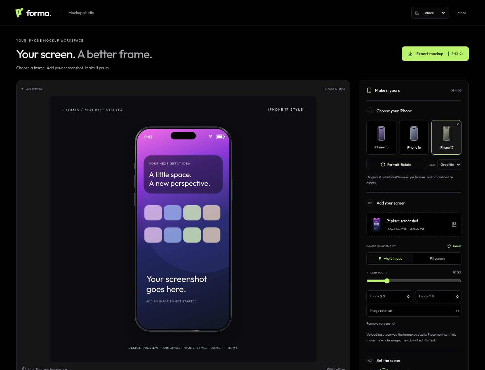

# Forma — iPhone Mockup Studio

A focused, browser-based workspace for presenting screenshots inside iPhone-style frames. Choose a frame, upload an image, adjust its placement, and download a finished mockup. No account or backend is required.

**[Browse screenshots and visual version history →](docs/screenshots/README.md)**



## Start the app

Use Node.js 24 LTS (Node 22+ supported) and npm:

```sh
npm ci
npm run dev
```

The app runs on port 3000. No API keys, credentials, database server or environment variables are needed. Fonts and artwork are bundled locally.

## The studio workflow

Both `/` and `/mockups` open Mockup Studio directly. The marketing-led homepage has been replaced with the actual workspace.

1. **Choose your iPhone:** original iPhone 15-, 16- or 17-style visual presets, portrait/landscape orientation, and Graphite/Silver finish. These are illustrative frames, not official Apple assets or exact hardware specifications. No Android preset is offered. iPhone 18 is omitted because a current verified frame is unavailable in this implementation.
2. **Add your screen:** upload or drop a PNG, JPEG or WebP image (up to 20 MB and 40 megapixels). Fit the whole image or fill/crop the screen; adjust zoom, horizontal/vertical position and rotation. Drag the image inside the frame to reposition it. Reset restores the full-image fit and zeroes placement adjustments.
3. **Set the scene:** choose a backdrop color, toggle the bezel/shadow, and optionally add a plain Dynamic Island and normal status bar with time, Wi-Fi and battery controls. No active-call timer is generated. Status overlays are switched off when an image is uploaded to avoid duplicating its own status details. If an upload already contains an active-call indicator, enable the standard status bar and **Replace screenshot status area**, then choose a matching background color. This intentionally overlays the top status area; the main screenshot content stays in place.
4. **Export:** download a 1600 × 1600 PNG. Export is independent of the displayed preview size and includes a design-preview caption outside the phone.

The default full-image fit can leave space around an image whose aspect ratio differs from the screen. **Fill screen** crops that space; placement controls let you choose which part stays visible. Rotation and zoom affect the whole screenshot.

**Images remain pixels.** The studio does not extract or automatically erase text or other content already present in an uploaded screenshot. The optional top-status-area replacement is an explicit overlay, not text reconstruction. The image can be positioned inside the frame without turning its transaction fields into editable controls.

Current studio images/settings live in memory and reset on refresh. Theme preferences persist. Use export to keep a finished mockup.

## Light, Dark and Black themes

The header theme selector offers:

- **Light** — the original warm light interface.
- **Dark** — the existing green-tinted dark palette.
- **Black** — a deeper neutral palette with a true-black page background.

The selected theme survives reloads. With no saved preference, the app starts from the system color preference. Studio backdrop color is separate from the interface theme, so a theme change does not change the exported scene.

## Existing workspaces

The **More** menu keeps **Saved projects** (`/projects`) and the **Image editor** (`/editor`) accessible. Existing IndexedDB projects are retained; no database migration or deletion is performed. These routes still support text/shapes/images, layers, history, editable-project saving and PNG/JPEG/WebP exports.

The legacy educational transaction layout is available from Saved projects and `/editor?template=transaction-demo`. Its fictional values remain editable, with permanent demonstration markings in the editor and exported image. Imported raster screenshots do not become editable text.

The fixed framed-image example is under **Reference mockup** in the studio. Its viewer downloads the bundled PNG without rewriting it; it does not expose its transaction text as editable fields.

## Validation

```sh
npm test
npm run typecheck
npm run lint
npm run test:e2e
npm run build
npm start
```

Playwright uses `/usr/bin/chromium` in the cloud environment. On another machine, install a supported Chromium and set `CHROMIUM_PATH`, or configure Playwright's browser installation. `BASE_URL` can target an already running production server.

The tests cover document/history behavior, educational-template persistence, studio geometry, theme persistence, import, placement/reset, export, existing projects and mobile layouts. See [validation evidence](docs/validation.md) for executed results and limitations. Phone tests use Chromium emulation; physical iPhones, Safari/WebKit, Firefox and a formal accessibility audit are not yet verified.

## Screenshot versions

Real running-app captures are stored under `docs/screenshots/`. Earlier versions remain available for comparison. The latest studio set is v6, including Light, Dark, Black, Silver-frame and mobile views.

```sh
# Start the app first; choose a fresh version folder.
npm run screenshots -- v7
# Or capture a running production instance:
BASE_URL=http://localhost:3001 npm run screenshots -- v7
```

The studio capture script makes a sample screenshot from Forma's original placeholder UI and uploads it through the real file input. Completed version folders are protected from overwriting. Historical scripts and earlier screenshots document the previous product layout.

## Deployment and offline support

Deploy as a Next.js Node service or on a compatible Next.js host:

```sh
npm ci
npm run build
npm start -- --port 3000
```

Use HTTPS in deployment. The app includes a manifest, icons and a production service worker for visited application assets. The cache version is `forma-studio-v6`; bump it for later releases. Offline support requires an earlier online visit and does not promise every route/chunk before first use.

`BASE_URL=http://localhost:3000 npm run test:offline` checks cached legacy-editor loading, editing and IndexedDB saving against a running production server. The command does not certify all native PWA installation behavior. No deployment is performed by editing these files.

## Module map

- `src/lib/mockup.ts`: typed studio options, visual presets and image-fit geometry.
- `src/components/mockup-studio.tsx`: upload, controls and export workflow.
- `src/components/mockup-canvas.tsx`: device renderer, clipped image placement and direct drag handling.
- `src/components/ui.tsx`: shared navigation and theme selector.
- `src/lib/document.ts`, `store.ts`, `storage.ts`, `import.ts`, `export.ts`: retained editor and project infrastructure.
- `tests/`: unit and real-browser regression tests.
- `scripts/studio-screenshots.mjs`: versioned captures of the current primary workflow.

The original [product specification](docs/product-specification.md) and [implementation notes](docs/implementation-plan.md) are retained as project history. Advanced OCR, automatic text reconstruction, cloud sync, native-device testing and production-scale performance profiling remain outside this first studio-focused iteration.
