# Forma visual version history

Real browser screenshots of the running Next.js application. Each folder is preserved so changes can be compared over time. Captures use Chromium, a 1440 × 1000 desktop viewport, and iPhone 13 emulation (390 × 664 CSS pixels, 3× raster density). These are browser captures, not design mockups or proof of physical-device testing.

## v5 — framed image example

The generated phone-frame image is now available in Mockup Studio as a fixed image viewer with an original-PNG download. Its transaction text is not editable.

[Capture metadata](v5/capture.json)

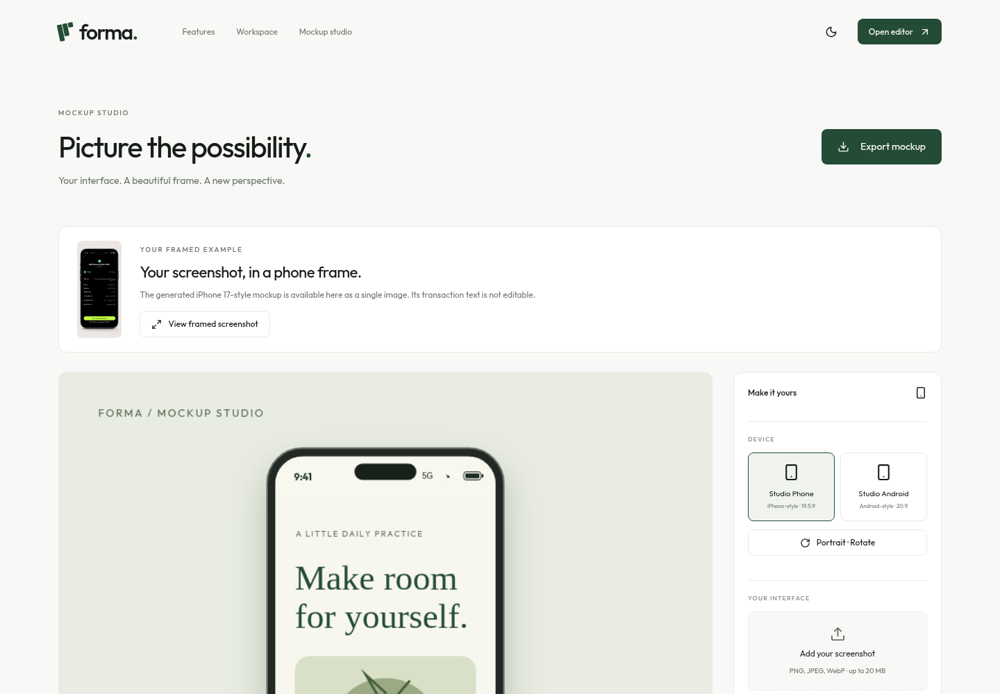

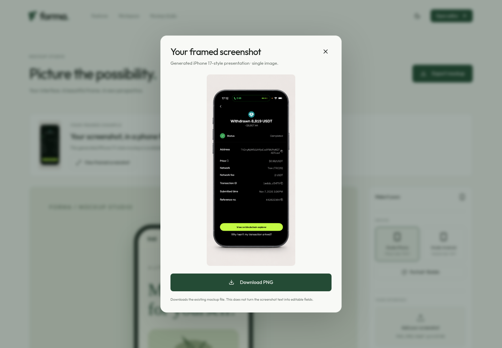

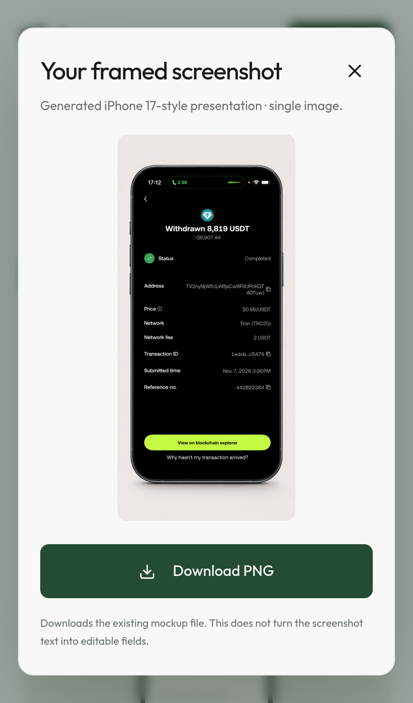

## v4 — educational transaction layout

A new fictional, layered example for practicing edits to the heading and right-hand fields. These captures show a template, not an altered real transaction screenshot. Demo markings remain visible in the canvas and export.

[Capture metadata](v4/capture.json)

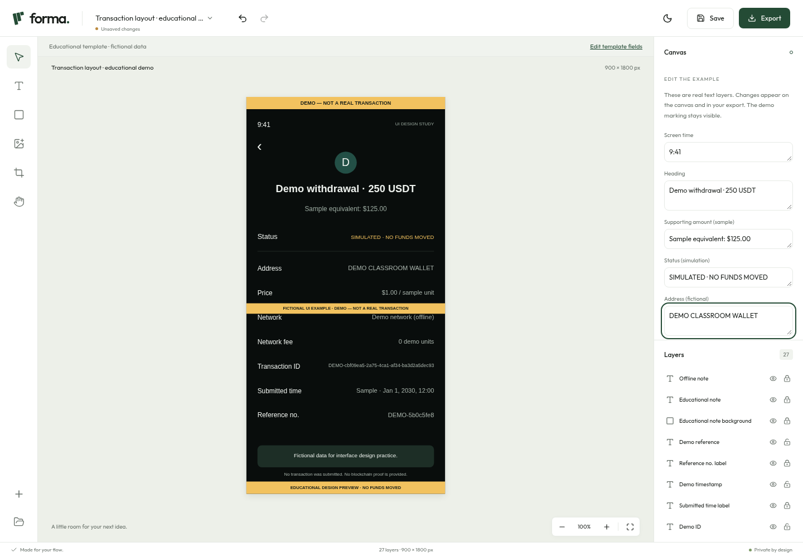

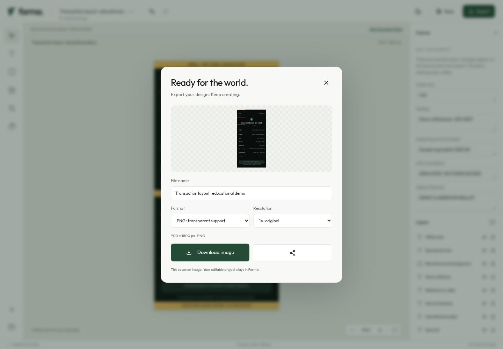

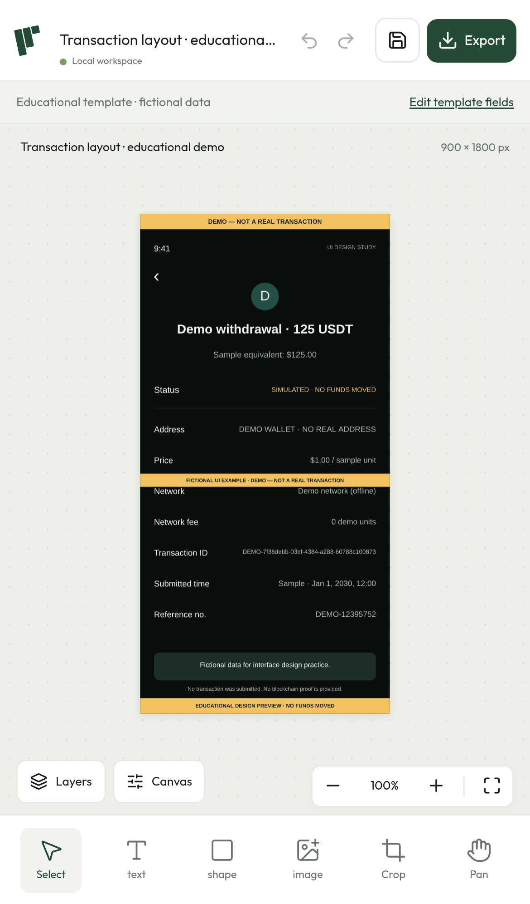 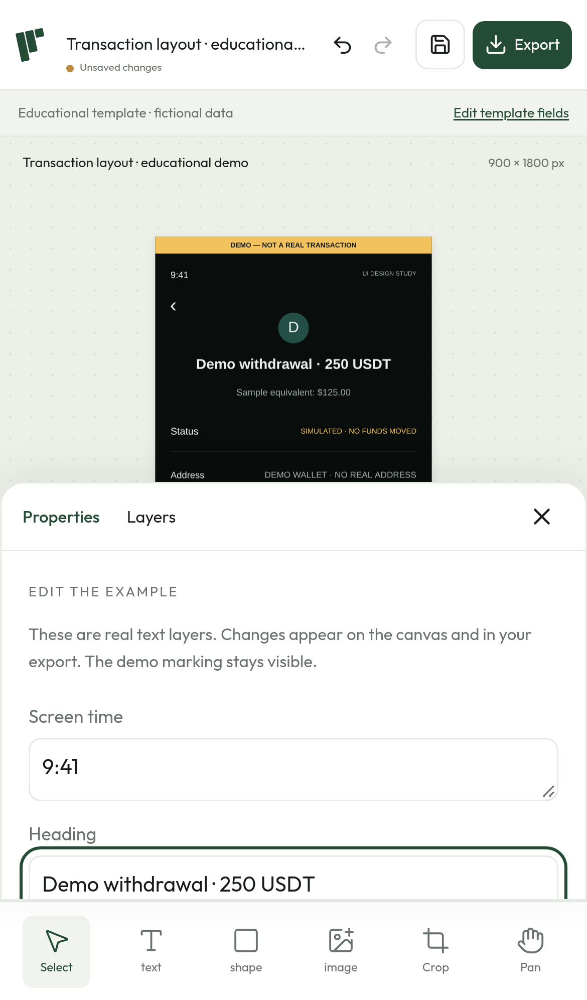

## v3 — reviewed first release

The latest review set includes responsive device-preview scaling, consistent screen-sized transform handles on mobile, crop/reset sizing fixes, and friendlier numeric entry.

[Capture metadata](v3/capture.json) · [Full desktop homepage](v3/02-home-desktop-full.png)

### Homepage

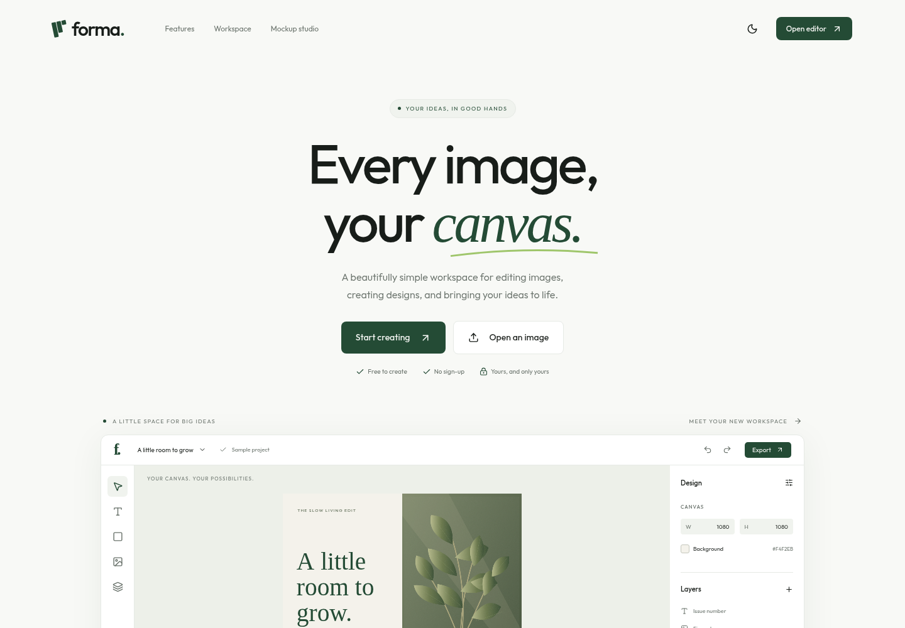

### Desktop editor

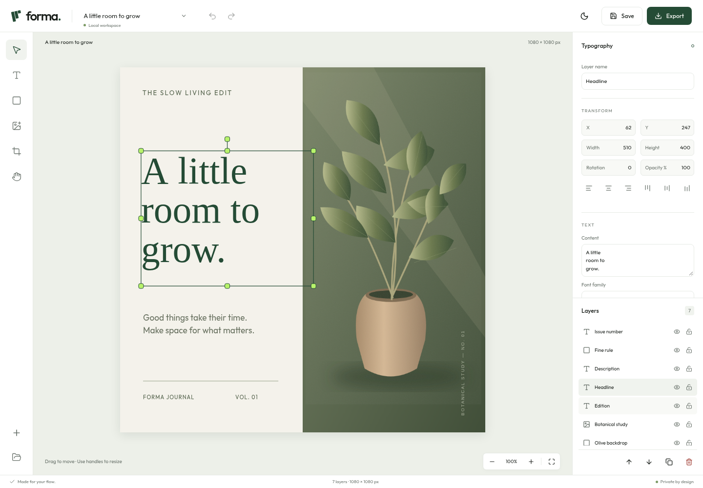

### Dark workspace

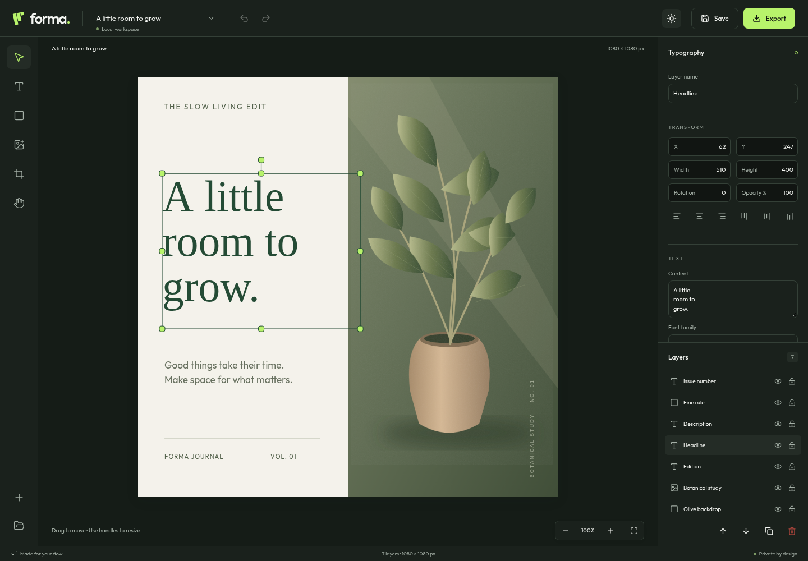

### Mobile editor

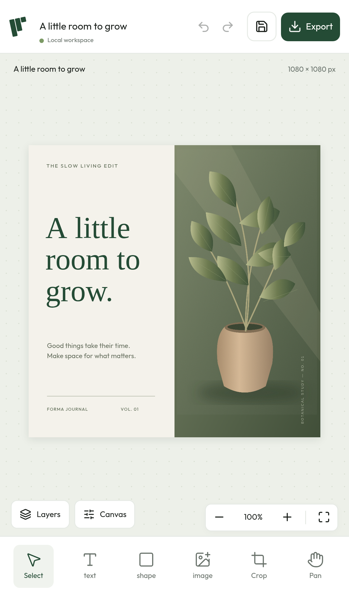 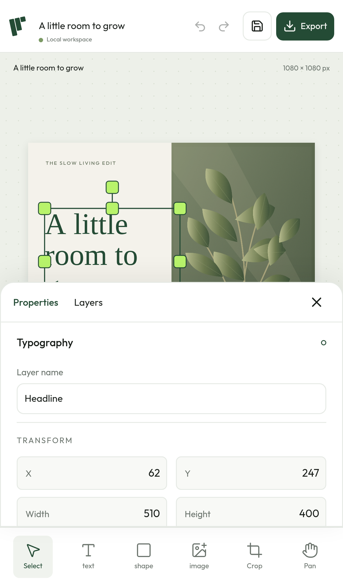

### Device mockup studio

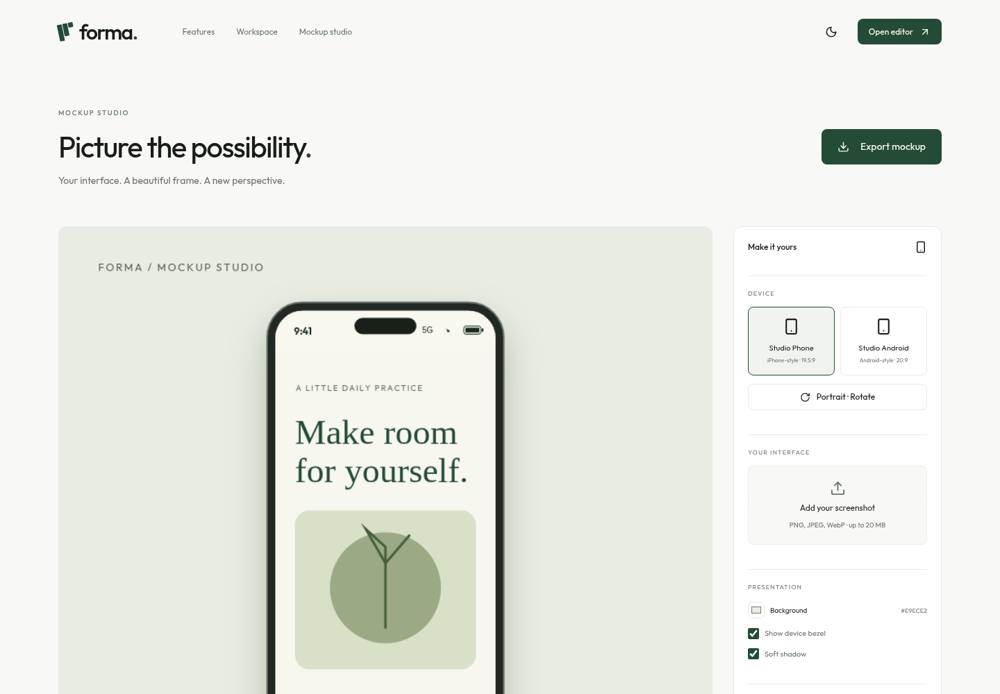

### All v3 screens

| Screen           | Screenshot                                                                    |
| ---------------- | ----------------------------------------------------------------------------- |
| Desktop homepage | [Viewport](v3/01-home-desktop.png) · [Full page](v3/02-home-desktop-full.png) |
| New project      | [Desktop dialog](v3/03-new-project-desktop.png)                               |
| Editor           | [Desktop](v3/04-editor-desktop.png) · [Dark](v3/05-editor-dark-desktop.png)   |
| Export           | [Preview and format controls](v3/06-export-desktop.png)                       |
| Local projects   | [Workspace](v3/07-projects-desktop.png)                                       |
| Mockup studio    | [Desktop](v3/08-mockup-desktop.png) · [Phone](v3/12-mockup-mobile.png)        |
| Mobile homepage  | [Full page](v3/09-home-mobile.png)                                            |
| Mobile editor    | [Canvas](v3/10-editor-mobile.png) · [Properties](v3/11-properties-mobile.png) |

## v2 — editor refinement

The second capture retains the editor handle and input refinements before the final responsive mockup-preview correction.

[Capture metadata](v2/capture.json) · [Desktop editor](v2/04-editor-desktop.png) · [Dark workspace](v2/05-editor-dark-desktop.png) · [Mobile properties](v2/11-properties-mobile.png) · [Mockup studio](v2/08-mockup-desktop.png) · [All captured files](v2/)

## v1 — initial working implementation

The first functional capture, retained as an earlier version. Visual review of this set led to the mobile-handle refinement in v2 and v3.

[Capture metadata](v1/capture.json)

| Screen           | Screenshot                                                                    |
| ---------------- | ----------------------------------------------------------------------------- |
| Desktop homepage | [Viewport](v1/01-home-desktop.png) · [Full page](v1/02-home-desktop-full.png) |
| New project      | [Desktop dialog](v1/03-new-project-desktop.png)                               |
| Editor           | [Desktop](v1/04-editor-desktop.png) · [Dark](v1/05-editor-dark-desktop.png)   |
| Export           | [Dialog](v1/06-export-desktop.png)                                            |
| Local projects   | [Workspace](v1/07-projects-desktop.png)                                       |
| Mockup studio    | [Desktop](v1/08-mockup-desktop.png) · [Phone](v1/12-mockup-mobile.png)        |
| Mobile homepage  | [Full page](v1/09-home-mobile.png)                                            |
| Mobile editor    | [Canvas](v1/10-editor-mobile.png) · [Properties](v1/11-properties-mobile.png) |

## Add a version

Start the application, then run `npm run screenshots -- v6`. Set `BASE_URL` to target another running server. The script refuses to overwrite a completed version folder. Add the new folder to this index and commit it with the corresponding source changes.
